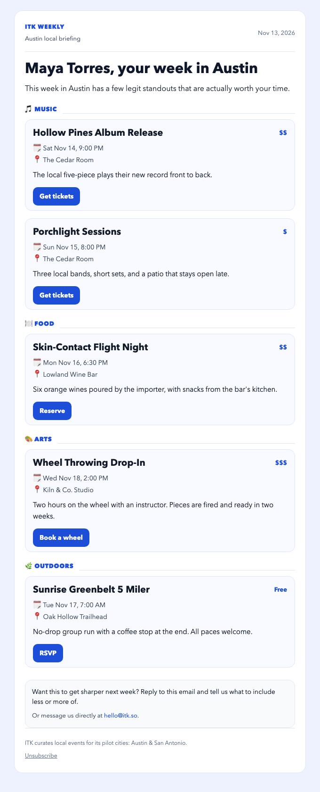
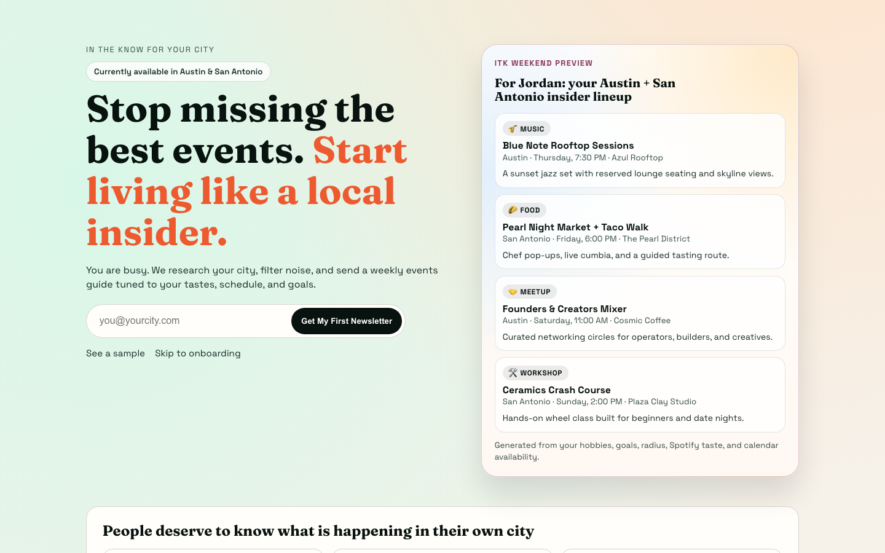
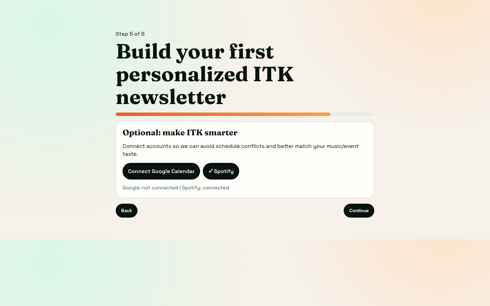
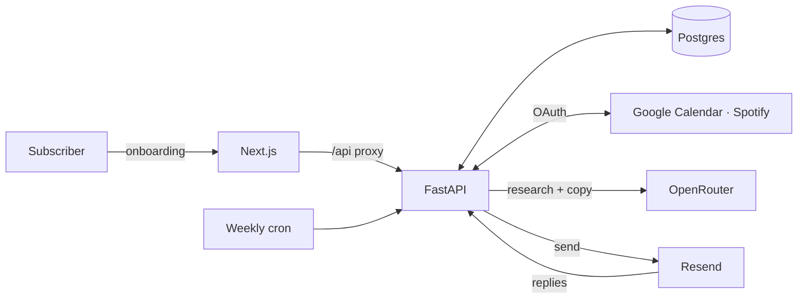

# ITK: In The Know

**A weekly local-events newsletter written for one person at a time.**

You tell ITK what you're into in your own words ("live indie music, natural wine, I want to
meet people who run"), connect Spotify and Google Calendar if you like, and every week you get
an email of real events in your city that fit your taste, your goals and your free evenings.
No two subscribers get the same issue. Reply "less rodeo stuff" and next week's issue knows.

<p align="center">
  
</p>

## What it does

- **Free-text onboarding.** A six-step wizard takes a brain dump of interests, goals (including
  the difference between "date night ideas" and "meet people to date"), how brief to be and how
  far you'll travel. Addresses autocomplete through Google Places. Cities outside the pilot get
  a waitlist instead of a dead end.
- **Shared research, personal writing.** Interests are parsed into tags shared across
  subscribers. Each `(interest, city)` pair is researched once a day with a web-grounded model,
  so popular interests cost one search no matter how many people share them. The copy for
  each issue is then written for the individual reader.
- **Venue-first discovery.** For each pilot city ITK keeps a list of the major music venues and
  reads their calendars every week. That surfaces shows a generic "music in Austin" search
  misses.
- **Context from your accounts.** Spotify listening steers the music picks, and Google
  Calendar free/busy keeps ITK from recommending things when you're booked. Tokens are
  encrypted at rest and refreshed automatically.
- **Reply to steer it.** Inbound replies are classified (add interests, remove interests,
  unsubscribe, feedback) and acted on. Feedback is rewritten with context and fed into the
  next issue's prompt.
- **Email that renders everywhere.** Table-based, inline-styled HTML with category sections,
  price indicators, per-event call-to-action buttons and one-click unsubscribe.

| Landing page | Onboarding |
|---|---|
|  |  |

*All screenshots use fabricated subscribers, venues and events from `backend/itk/seed.py`.*

## How it works



Every week the pipeline runs six isolated steps: **parse** new interest text into tags,
**research** events per `(tag, city)` pair (cached 24h), **discover** venues (monthly),
**read venue calendars**, **draft** each subscriber's issue, and **send**. A failed step is
logged and reported while the rest carry on, so a slow search never blocks the send. On
serverless hosts the cron fans out one short invocation per subscriber.

More detail in [docs/architecture.md](docs/architecture.md).

## Quickstart

Runs fully offline: no API keys, no database server. AI steps fall back to heuristics and
email is written to `backend/.outbox/` as HTML files.

Requires [uv](https://docs.astral.sh/uv/) and Node 22+.

```bash
git clone https://github.com/joey12725/in-the-know.git && cd in-the-know
cp .env.example .env
make setup        # uv sync + npm ci
make demo         # SQLite schema, 3 fabricated subscribers, full pipeline run
open backend/.outbox/*.html
```

Then run the app:

```bash
make backend      # http://localhost:8000  (API docs at /docs)
make frontend     # http://localhost:3000
```

Sign up through the wizard with any Austin or San Antonio address; the welcome email lands in
`backend/.outbox/`. Add an `OPENROUTER_API_KEY` to `.env` to switch on live event research and
copywriting, and Google/Spotify credentials to try the OAuth flows.

For Postgres instead of SQLite, `docker compose up -d db` and point `DATABASE_URL` at it (see
[docs/configuration.md](docs/configuration.md)).

## Tests and checks

```bash
make check        # ruff, mypy --strict, eslint, tsc, pytest, node --test
```

The backend suite covers signup and CSRF, the full OAuth connect/callback/refresh cycle
against mocked Google and Spotify token endpoints, newsletter drafting and sending, the reply
agent, webhook signature checks and the end-to-end pipeline. It runs on SQLite by default and
on Postgres in CI, where a migration test also fails the build if the models drift from the
Alembic history.

## Tech stack

- **Frontend:** Next.js 16 (App Router), React 19, TypeScript
- **Backend:** Python 3.12, FastAPI, SQLAlchemy 2, Alembic, Pydantic Settings, httpx, slowapi
- **Data:** Postgres (Neon in production), SQLite for local demos and tests
- **AI:** OpenRouter with separate roles: Perplexity Sonar for web-grounded research, GPT for
  structured extraction and copywriting
- **Email:** Resend for outbound and inbound (Svix-signed webhooks)
- **Integrations:** Google Calendar and Spotify over OAuth 2.0, Google Places autocomplete
- **Tooling:** uv, ruff, mypy (strict), pytest + respx, ESLint, GitHub Actions
- **Hosting:** Vercel (two projects: Next.js and the FastAPI function)

## Project layout

```
backend/    FastAPI app (itk/), Alembic migrations, tests
frontend/   Next.js app: landing page, onboarding wizard, /api proxy
shared/     test vectors used by both the Python and TypeScript tests
docs/       architecture, configuration and deployment, extending
```

## Docs

- [Architecture](docs/architecture.md): pipeline, reply loop, OAuth, data model
- [Configuration and deployment](docs/configuration.md): every env var, Vercel, cron, Resend
- [Extending](docs/extending.md): new cities, new integrations, models, pipeline steps

## License

MIT. Built by [Joey Hersh](https://github.com/joey12725).
