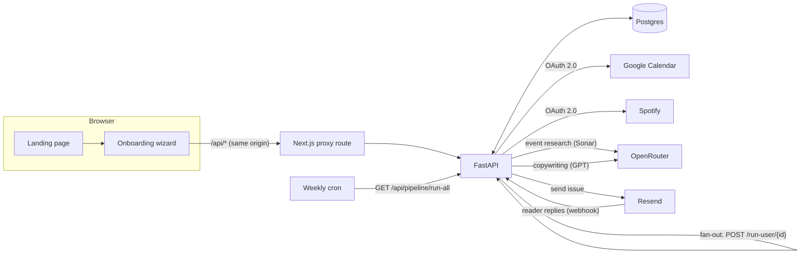
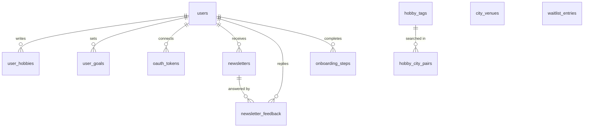

# Architecture

ITK is two deployables and one database:

| Piece | Stack | Job |
|---|---|---|
| `frontend/` | Next.js 16 (App Router), React 19, TypeScript | Landing page, six-step onboarding wizard, and a catch-all `/api/*` route that proxies to the backend so the browser only ever talks to one origin |
| `backend/` | FastAPI, SQLAlchemy 2, Alembic, httpx | Public signup API, OAuth, the weekly pipeline, inbound reply webhook |
| Postgres | Neon in production, Docker or SQLite locally | Subscribers, interests, cached research, issues, feedback |



## Backend layout

```
backend/itk/
├── main.py              app factory: CORS, rate limiting, security headers, routers
├── config.py            every setting, from env vars / .env
├── db.py                lazy engine + session, portable JSON type, UTC helpers
├── models.py            all eleven tables
├── schemas.py           request/response bodies
├── security.py          HMAC-signed tokens, CSRF, Svix verification, cron auth, rate-limit key
├── cities.py            pilot-city normalization (mirrored in frontend/lib/cities.ts)
├── pipeline.py          the weekly run as isolated steps
├── cli.py, seed.py      init-db / seed / run-pipeline, fabricated demo data
├── routes/              public, oauth, pipeline, webhooks, health
└── services/
    ├── llm.py           OpenRouter client with chat / search / write roles + JSON extraction
    ├── hobbies.py       free text -> shared tags -> (tag, city) pairs
    ├── events.py        per-pair event research, cached 24h
    ├── venues.py        venue discovery (monthly) and venue calendars (weekly)
    ├── oauth.py         provider registry, encrypted token storage, refresh-on-read
    ├── integrations.py  Google free/busy, Spotify recently played
    ├── newsletter.py    assemble context, write copy, draft, send
    ├── newsletter_template.py   email-safe HTML
    ├── reply_agent.py   classify replies and act on them
    ├── mailer.py        Resend, or a local .outbox/ folder
    └── welcome_email.py
```

## The weekly pipeline

`itk/pipeline.py` runs six steps. Each one is wrapped so a failure is logged, rolled back and
reported in the result instead of aborting the run: if event search times out, issues still go
out with whatever research is cached.

1. **Parse interests.** Each subscriber's free-text "word vomit" becomes up to 12 tags
   (`parse_hobby_tags`). Tags are shared across subscribers, and every new tag bumps the
   frequency of its `(tag, city)` pair. Text that was already parsed is skipped, so the LLM is
   called once per edit rather than once per week.
2. **Research events per pair.** The most popular pairs are searched first with a web-grounded
   model (Perplexity Sonar via OpenRouter). Results are cached on the pair for 24 hours, so a
   thousand people who like "live jazz" in Austin cost one search, not a thousand.
3. **Discover venues.** Each pilot city keeps a list of major music venues, refreshed monthly.
4. **Search venue calendars.** Each venue's upcoming shows are researched weekly. Generic
   "music in Austin" searches miss most of these.
5. **Draft.** For each subscriber, ITK merges venue events with the cached results for *their
   own* interests (topped up with the city's popular pairs), then hands the writing model:
   parsed tags, the raw interest text, goals, dating preference, recent reply feedback,
   Spotify listening and Google Calendar busy windows. The model returns a subject and a
   one-sentence intro, which are cleaned against a list of banned phrases before rendering.
   A subscriber with no events gets no issue that week.
6. **Send.** Each issue goes out through Resend with a plus-addressed reply-to
   (`reply+<issue-id>@domain`) and a `List-Unsubscribe` header pointing at a signed one-click
   unsubscribe link.

On serverless hosts a single invocation is capped at a few seconds, so production runs the
weekly cron against `GET /api/pipeline/run-all`. That endpoint dispatches one
`/api/pipeline/run-user/{id}` request per subscriber (ten at a time, waiting only until each
request is delivered) and each subscriber is drafted and sent in their own invocation from the
cached research. Steps 1 to 4 can also be called individually (`/parse-hobbies`,
`/search-events`, `/discover-venues`, `/search-venue-events`).

## The reply loop

Readers can just answer the email. Resend posts inbound mail to `/api/webhooks/email-reply`,
which is verified with Resend's Svix signature. The reply agent matches the reply to an issue
through the plus-addressed recipient (or falls back to the sender address), then classifies it:

| Intent | Effect |
|---|---|
| `add_interests` | appended to the subscriber's interests and re-parsed |
| `remove_interests` | matching tags dropped, preference stored as feedback |
| `unsubscribe` | subscription turned off |
| `feedback` | rewritten with context ("doesn't want rodeo events in the San Antonio issue; was shown ...") and stored |

The six most recent feedback entries go into the next issue's copywriting prompt, so the
newsletter adjusts week to week without anyone touching a settings page.

## OAuth

Google Calendar and Spotify share one implementation (`services/oauth.py`). Each provider is a
small dataclass with its URLs, scopes and extra authorize params; the routes are generic over
the provider name. The `state` parameter is an HMAC-signed, ten-minute token carrying the user
ID and onboarding token, so the callback needs no server-side session. Tokens are
Fernet-encrypted at rest and refreshed transparently when read after expiry; a failed refresh
simply means "no calendar/music context" for that issue.

## Security notes

- CSRF: double-submit cookie on every state-changing public endpoint.
- Signup is rate limited per client IP (first `X-Forwarded-For` hop behind the proxy).
- User text is stripped of HTML on the way in and escaped on the way out.
- Pipeline endpoints require `X-Cron-Secret` or `Authorization: Bearer <secret>`.
- In production the app refuses to start with default secrets, and the reply webhook refuses
  unsigned requests.

## Data model



`hobby_city_pairs.cached_results` and `city_venues.cached_events` hold research as JSONB. The
Alembic migrations are the source of truth for the schema; `tests/test_migrations.py` runs them
against Postgres and fails if the SQLAlchemy models drift from them.
